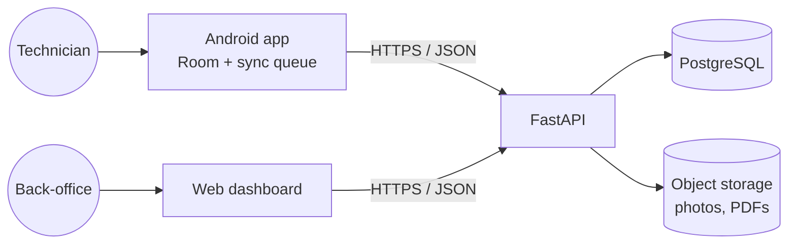

# FieldLog - Technical plan

_Phase: PLAN · Date: 2026-10-07 · ADRs: `docs/adr/`_

## 1. Stack decision
Weights agreed with the user: platform fit 5, team skills 5, maturity 4, security record 3, cost 3, time to market 3, ecosystem 2, performance 2.

| Area | Recommended | Alternative A | Alternative B | User decision | ADR |
|---|---|---|---|---|---|
| Android | Kotlin + Compose + Room (4.5) | Flutter (3.9) | React Native (3.6) | Kotlin | 0001 |
| Backend | Python + FastAPI (4.4) | Django REST (4.1) | Node + NestJS (3.5) | FastAPI | 0001 |
| Database | PostgreSQL 16 (4.6) | MySQL 8 (3.9) | SQLite on server (2.8) | PostgreSQL | 0001 |
| Web | React + TS + Vite (4.0) | Vue 3 (3.9) | server-rendered Jinja (3.4) | React | 0001 |
| Containers | API + DB in Docker (4.2) | PaaS build from source (3.8) | VM without containers (2.9) | Docker | 0002 |

## 2. Architecture

- Sync: client-generated UUIDs, outgoing queue, server keeps both versions on conflict (`conflict=true`).
- Personal data: customer name, address, signature (marked in the data model); EU hosting.

## 3. Containers
Yes - see ADR 0002. `Dockerfile` (multi-stage, non-root, digest-pinned base, healthcheck) and `docker-compose.yml` for development.

## 4. Environments, branching, CI/CD
| Environment | Purpose | Data |
|---|---|---|
| dev | docker compose on laptops | synthetic |
| test | EU VM, deployed on every main merge | synthetic |
| prod | EU VM | real |

Trunk-based, Conventional Commits, SemVer. CI: lint -> typecheck -> tests -> build image -> gitleaks, semgrep, SCA, trivy.

## 5. Brand and UX
Tokens `design/tokens.json` (contrast check: 6/6 pass) · logo `design/logo.svg` (direction B, "Steel & Signal") · wireframes for sign-in, job form, job list, dashboard.

## 6. Security
Threat model `docs/security/threat-model.md`; new requirement R-005 from TM-01.

## 7. Risk register
| Risk | P | I | Score | Mitigation | Owner |
|---|---|---|---|---|---|
| Sync conflicts lose data | 3 | 5 | 15 | keep-both policy, conflict tests (AC-002.2) | developer |
| Technicians reject the app (speed) | 3 | 4 | 12 | 60-second rule, UAT with two technicians | analyst-pm |
| Photo storage costs | 2 | 2 | 4 | compression (AC-002.3) | architect |
