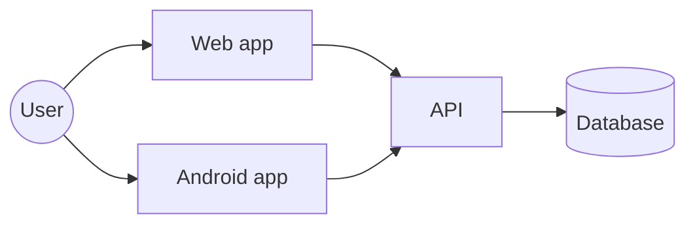

# {{Product name}} - Technical plan

_Phase: PLAN · Date: {{YYYY-MM-DD}} · ADRs: `docs/adr/`_

## 1. Stack decision
Criteria weights: {{platform fit 5, team skills 4, ...}}

| Area | Recommended | Alternative A | Alternative B | User decision | ADR |
|---|---|---|---|---|---|
| {{Backend}} | {{option (score)}} | {{...}} | {{...}} | {{...}} | 0001 |

## 2. Architecture

Components and responsibilities: {{...}}
Data model: {{entities, relations, personal data marked}}
Integrations and external services: {{...}}

## 3. Containers
Decision: {{yes/no}} - ADR {{000x}}. Services: {{...}}

## 4. Environments, branching, CI/CD
| Environment | Purpose | URL/host | Data |
|---|---|---|---|
Branching: {{trunk-based}} · Commits: Conventional Commits · Versioning: SemVer
CI pipeline: lint -> typecheck -> test -> build -> security scans -> {{deploy}}

## 5. Brand and UX
Tokens: `design/tokens.json` (contrast check: {{pass}}) · Logo: `design/logo.svg` · Wireframes: `design/wireframes/`

## 6. Security
Threat model: `docs/security/threat-model.md` · New security requirements: {{R-ids}}

## 7. Risk register
| Risk | Probability (1-5) | Impact (1-5) | Score | Mitigation | Owner |
|---|---|---|---|---|---|

## 8. Licenses
Project license: {{MIT}} · Dependency licenses checked: {{yes, list exceptions}}
