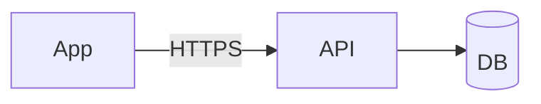

# {{Product name}} - Threat model

_Phase: PLAN · Method: STRIDE + privacy · Date: {{YYYY-MM-DD}}_

## Scope
Assets: {{accounts, personal data, payments, ...}}
Actors: {{users, admins, anonymous internet, other services}}
Trust boundaries: {{device <-> API, API <-> database, API <-> third party}}

## Data flow

## Threats
| ID | Component / flow | STRIDE | Threat | Likelihood | Impact | Mitigation | Maps to |
|---|---|---|---|---|---|---|---|
| TM-01 | login | S | credential stuffing | high | high | rate limit, MFA option, breached-password check | R-0xx, T-0xx |

## Privacy (GDPR)
| Data | Purpose | Legal basis | Retention | Deletion path | Transfers |
|---|---|---|---|---|---|

## Residual risks
{{Accepted by the user? when, why}}
